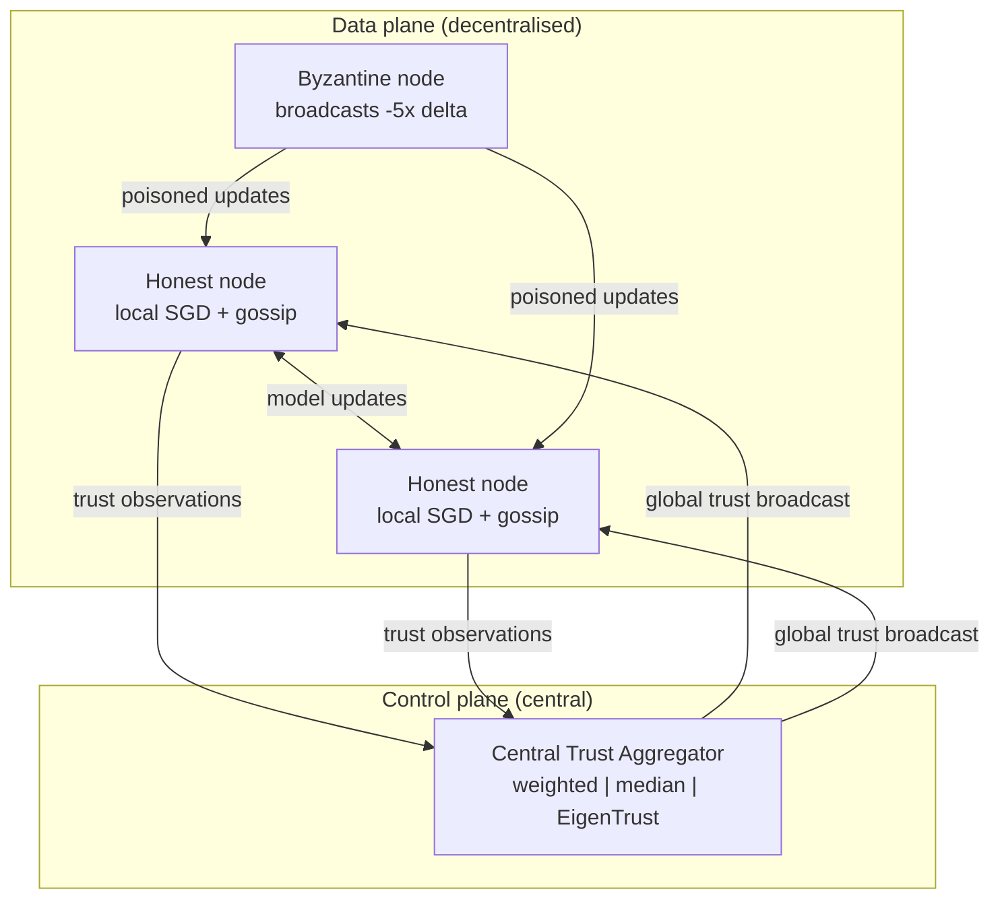

# Gossip Learning with a Central Trust Aggregator
<!-- 

 -->

A small, readable PyTorch simulation of **Byzantine-resilient gossip learning** with a hybrid design: model training and exchange are fully decentralised, while a lightweight **Central Trust Aggregator (CTA)** collects trust *observations* (never model weights) and broadcasts global trust scores back to the nodes.

It is inspired by [GRANITE](https://arxiv.org/abs/2504.17471) (robust gossip learning with Byzantine nodes) and adds a CTA, three pluggable trust strategies, and a FederatedTrust-style multi-dimensional score. Everything lives in one file, [`granite.py`](granite.py), and runs on a laptop CPU or in Colab.

> **Scope note.** This is a student research simulation, not a reproduction of the GRANITE paper and not production code. The components are deliberately simplified versions of the originals, and every simplification is listed in [Limitations](#limitations-and-honest-scope). Results below come from a **single seed**.

---

## Contents

- [Why this exists](#why-this-exists)
- [Architecture](#architecture)
- [Components](#components)
- [Quick start](#quick-start)
- [Command-line options](#command-line-options)
- [Experimental setup](#experimental-setup)
- [Results](#results-single-run-seed-42)
- [Limitations and honest scope](#limitations-and-honest-scope)
- [Planned experiments](#planned-experiments)
- [Repository layout](#repository-layout)
- [References](#references)
- [Authors](#authors)

---

## Why this exists

Gossip learning removes the central parameter server of federated learning: each node trains locally and exchanges models with a few random peers. That removes the single point of failure, but it makes adversaries harder to handle. A Byzantine node can send poisoned updates, and in a purely peer-to-peer setting trust about that node has to spread hop by hop.

The question this project explores:

> Can a *small* amount of centralisation, limited to trust signals and never touching model weights, make gossip learning more robust without bringing back a central training server?

The trade-off is explicit: the CTA is a new attack surface and a (soft) single point of failure for *trust enforcement*, but not for *learning*. If the CTA goes down, nodes still train and gossip; they just lose the global trust signal.

## Architecture



**One round**

1. Every node trains one local epoch and produces an update (its weight delta). A Byzantine node broadcasts `-5 x delta` instead.
2. Each honest node samples a *view* of 5 peers. For the first 3 rounds sampling is uniform; afterwards it is weighted by effective trust.
3. The node computes the norm of each received update, flags outliers with APT, builds a robust reference direction, and records the cosine similarity of every peer to it.
4. It aggregates the surviving updates with GTS and applies the result.
5. All honest nodes submit their `TrustObservation` records to the CTA, which updates global trust.
6. Global trust is fed back into peer sampling: `tau_eff = 0.7 * global + 0.3 * local`.

## Components

| Component | Role | Centralised? |
|---|---|---|
| `GraniteNode` | Local training, gossip exchange, aggregation | No |
| `HaPSLite` | Uniform sampling during warm-up, then trust-weighted peer sampling | No (per node) |
| `APTLite` | Flags updates whose L2 norm exceeds `3x` a running trimmed median; never discards more than half the view | No (per node) |
| `gts_aggregate` | Simplified trimmed aggregation: drop the update farthest from the centroid, average the rest | No (per node) |
| `TrustObservation` | Per-peer record: cosine to robust centroid, update norm, APT flag | n/a |
| `WeightedAverageAggregator` | Decayed mean of observer scores, weighted by each observer's own trust (default) | **Yes** |
| `MedianAggregator` | Trimmed median of per-round scores, smoothed with an EMA | **Yes** |
| `EigenTrustAggregator` | Power iteration over an observer x target score matrix | **Yes** |
| `TrustEvaluator` | Six-pillar FederatedTrust-style score (see below) | **Yes** |

### Trust_FL score

A weighted mean of six pillars in `[0, 1]` (weights 2.0 / 2.0 / 1.5 / 1.0 / 1.5 / 1.0, normalised).

| Pillar | How it is computed | Measured from the run? |
|---|---|---|
| Privacy | `0.10` baseline, plus bonuses for DP / secure aggregation (neither is implemented) | No, fixed at 0.10 |
| Robustness | Mean of accuracy, `1 - CTA trust in Byzantine nodes`, `1 - share of Byzantine updates that passed APT` | Yes |
| Fairness | `1 - coefficient of variation` of honest-node sampling counts, averaged with per-node accuracy spread | Yes |
| Explainability | Bucketed by parameter count (76,018 params gives 0.45) | No, config-derived |
| Accountability | Weighted completeness of a factsheet dictionary | No, config-derived |
| Federation | Log-scaled inter-node parameter variance | Yes (but saturates, see below) |

> **Read this score as a dashboard, not a benchmark.** It is a heuristic inspired by the FederatedTrust taxonomy, not a validated metric. Three of six pillars are constants of the configuration. Use the raw metrics (accuracy, Byzantine trust, APT detection / false-positive rate, Byzantine sampling share) for any real claim.

## Quick start

### Local

```bash
git clone https://github.com/Shiva-gsk/<repo-name>.git
cd <repo-name>
pip install -r requirements.txt

python granite.py --synthetic --rounds 5      # offline smoke test, no download
python granite.py                             # real MNIST, 50 rounds, seed 42
python granite.py --seeds 0 1 2 3 4           # several seeds, prints mean +/- std
python granite.py --aggregator eigentrust     # weighted | median | eigentrust
```

MNIST is downloaded to `./data` on first run.

### Google Colab

Upload `granite.py` to the session (torch, torchvision and matplotlib are preinstalled), then:

```python
%run granite.py --synthetic --rounds 5        # smoke test
```

```python
import granite
res = granite.run(rounds=50, seeds=[0, 1, 2, 3, 4])
```

If you re-upload the file, restart the runtime so `import granite` picks up the new copy. Colab storage is wiped when the session ends, so download `results/` before closing it.

### Outputs

For each seed the run writes, under `results/`:

- `<aggregator>_seed<N>.json`: full config, per-round metrics, and a summary
- `<aggregator>_seed<N>.csv`: the same per-round metrics as a table
- `<aggregator>_seed<N>.png`: a 6-panel dashboard (accuracy, trust in Byzantine node, Byzantine share of views, APT detection / false positives, Trust_FL, final pillars)

## Command-line options

| Flag | Default | Meaning |
|---|---|---|
| `--rounds` | 50 | Communication rounds |
| `--nodes` | 10 | Total nodes |
| `--byzantine` | 1 | Number of Byzantine nodes (ids `0..k-1`) |
| `--view-size` | 5 | Peers sampled per node per round |
| `--aggregator` | `weighted` | CTA strategy: `weighted`, `median`, `eigentrust` |
| `--seeds` | 42 | One or more seeds; a summary table is printed across them |
| `--train-per-node` | 100 | MNIST training samples per node |
| `--test-samples` | 1000 | Random MNIST test images used for accuracy |
| `--synthetic` | off | Class-prototype synthetic data (offline smoke test only) |
| `--out` | `results` | Output directory |
| `--no-plots` | off | Skip figure generation |

Other knobs (learning rate, APT multiplier / window, CTA decay, flag penalty, attack scale, trust blend) live in `ExperimentConfig` at the top of `granite.py`.

## Experimental setup

| Parameter | Value |
|---|---|
| Dataset | MNIST, seeded random subset: 1,000 train (100 per node, IID split), 1,000 test |
| Model | Small CNN (2 conv + 2 FC), 76,018 parameters, shared initial weights |
| Local training | 1 epoch SGD per round, lr 0.01, momentum 0.9, batch 32 |
| Nodes / Byzantine | 10 / 1 (10%) |
| View size | 5 |
| Rounds | 50 (3 warm-up rounds with uniform sampling) |
| Attack | Scaled sign-flip: Byzantine broadcasts `-5 x` its honest delta |
| APT | multiplier 3.0, window 5, minimum 50% of the view kept |
| CTA | weighted average, decay 0.85, flag penalty 0.15, observer-trust weighting |
| Accuracy metric | Mean of honest-node parameters, evaluated on the test subset |

## Results (single run, seed 42)


Selected rounds from one run (`python granite.py`, CTA = weighted, seed 42):

| Round | Accuracy | Byzantine CTA trust | Byzantine share of views | Trust_FL |
|---:|---:|---:|---:|---:|
| 1 | 0.113 | 0.000 | 0.13 | 0.636 |
| 5 | 0.116 | 0.000 | 0.04 | 0.626 |
| 10 | 0.483 | 0.000 | 0.02 | 0.649 |
| 20 | 0.815 | 0.000 | 0.00 | 0.697 |
| 30 | 0.865 | 0.000 | 0.02 | 0.708 |
| 40 | 0.877 | 0.000 | 0.00 | 0.694 |
| 50 | 0.869 | 0.000 | 0.00 | 0.697 |

- **Final accuracy 0.869; peak 0.893 at round 43.** Quote both numbers, not just the peak.
- **APT caught every Byzantine update that appeared in a view** (detection 1.00 in all 26 rounds where the node was sampled) and produced only two false-positive rounds out of 50 (about 9% of honest slots in each).
- **The Byzantine node's share of honest views falls from 0.13 (uniform warm-up) to roughly 0.00-0.04**, and is 0 in most late rounds.
- **The worst honest node is noticeably worse than the mean** (about 0.78 at the end, with a dip to roughly 0.35 at round 31), so the mean-model accuracy flatters per-node behaviour.

### What these results do and do not show

They show that with an obvious attack (a 5x sign-flipped update), the pipeline of norm filtering, cosine-based observations, and trust-weighted sampling isolates the attacker almost immediately and the honest nodes still learn.

They do **not** show:

- **Gradual trust consensus.** Byzantine CTA trust is 0.000 from round 1. A `-5x` update has a strongly negative cosine and a huge norm, so every observer reports it at once and the flag penalty saturates. The CTA's speed here comes from the attack being easy to detect, not from the design being fast in general. The slowly decaying "mean local (HaPS)" curve in the dashboard shows what purely local trust looks like: it only drops when a node happens to sample the attacker.
- **That the CTA helps.** There is no ablation yet (no CTA, no APT, no defence at all). Without those controls, "hybrid beats decentralised" is a hypothesis, not a result.
- **Robustness to subtle attacks.** Small-norm, in-distribution, or colluding attacks have not been tried.
- **Statistical significance.** One seed, 1,000 training images in total, 1,000 test images.
- **Anything about Privacy.** No differential privacy or secure aggregation is implemented.

Two further caveats on the Trust_FL number: the Federation pillar sits at 1.00 for most of the run (the inter-node variance is tiny with this model and horizon), so it carries little information; and in rounds where the Byzantine node is not sampled, the "poison passed APT" term is defined as 0, which inflates Robustness slightly.

## Limitations and honest scope

What this code does **not** do, compared with the papers it draws on:

- **`HaPSLite` is not GRANITE's HaPS.** The paper's History-aware Peer Sampling keeps a monotonically growing set of encountered identifiers and proves exponential decay of the Byzantine share in local views. This implementation uses trust-weighted sampling after a warm-up and has no such guarantee.
- **`APTLite` is not GRANITE's APT.** The paper derives adaptive thresholds from a Chernoff bound on the Byzantine fraction. This implementation uses a `3x` multiple of a trimmed running median of update norms.
- **`gts_aggregate` is a simplified geometric trimmed summation:** drop the single update farthest from the centroid and average the rest.
- **The attack is a scaled sign-flip**, not the Fall-of-Empires attack (which scales against the *honest mean*).
- **Byzantine nodes do not submit trust observations**, so trust manipulation of the CTA is not evaluated. The CTA itself is assumed honest and available.
- **IID data only.** No non-IID partitions, no churn, no Sybil or collusion attacks.
- **Small scale:** 10 nodes, 1 Byzantine node, a 1,000-image training set.
- **A complete graph is simulated.** Peers are drawn from all other nodes, not from a sparse topology.

## Planned experiments

These are the experiments needed before any strong claim. Commands marked with a star already work; the rest need small code changes.

| Experiment | Question | Status |
|---|---|---|
| Multiple seeds (`--seeds 0 1 2 3 4`) * | How much do the numbers vary? | To run |
| `--byzantine 0` * | What is the no-attack accuracy ceiling? | To run |
| `--byzantine 3` * | Does isolation still work at 30%? | To run |
| `--aggregator median` / `eigentrust` * | Do the three CTA strategies differ in isolation speed? | To run |
| No-CTA ablation (`global_blend = 0`) | Does the CTA actually help over local trust alone? | Needs a flag |
| No-defence baseline (plain averaging) | How badly does the attack hurt without APT, GTS and trust? | Needs a flag |
| Subtler attacks (small-norm, Fall of Empires, colluding nodes) | Does detection survive when the attack is not obvious? | Needs code |
| Non-IID (Dirichlet) splits | Do honest nodes get falsely flagged when data is heterogeneous? | Needs code |
| Lying Byzantine observers | How robust is each CTA strategy to false reports? | Needs code |
| Scale to 50-100 nodes, sparse views | Does it hold beyond toy size? | Needs code |

## Repository layout

```
.
├── granite.py            # everything: data, nodes, CTA strategies, evaluator, runner, plots
├── requirements.txt
├── README.md
├── .gitignore            # ignores data/ and results/
└── docs/
    └── results_weighted_seed42.png   # dashboard from the run shown above
```

## References

References are as cited in the original project report; please verify details against the sources before citing them elsewhere.

1. GRANITE: Robust Gossip Learning in the Presence of Byzantine Nodes. arXiv:2504.17471, 2025.
2. I. Hegedus, M. Jelasity, R. Ormandi. *Gossip Learning as a Decentralized Alternative to Federated Learning.* DAIS 2019, LNCS 11534, pp. 74-90.
3. *Toward Trustworthy Federated Learning.* Future Generation Computer Systems, vol. 148, 2023. doi:10.1016/j.future.2023.06.019
4. *Byzantine-Resilient Decentralized Learning.* Parallel Computing, vol. 99, 2020. doi:10.1016/j.parco.2020.102661
5. Y. LeCun, C. Cortes, C. Burges. *The MNIST Database of Handwritten Digits*, 1998.

## Authors

Built by **Gulapala Shiva Kumar** as a semester project at the Department of Computer Science and Engineering, NIT Calicut, under the supervision of **Dr. Vinod Pathari**.

## License

Add a `LICENSE` file (MIT is a common choice for research code) and name it here.